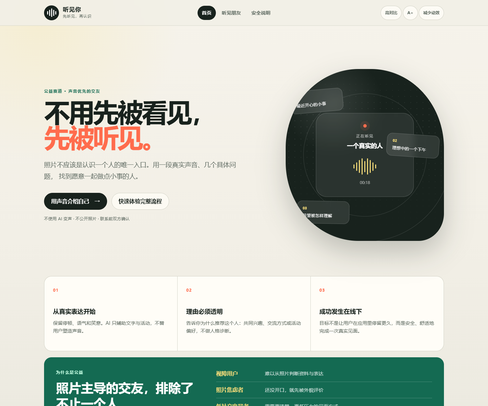
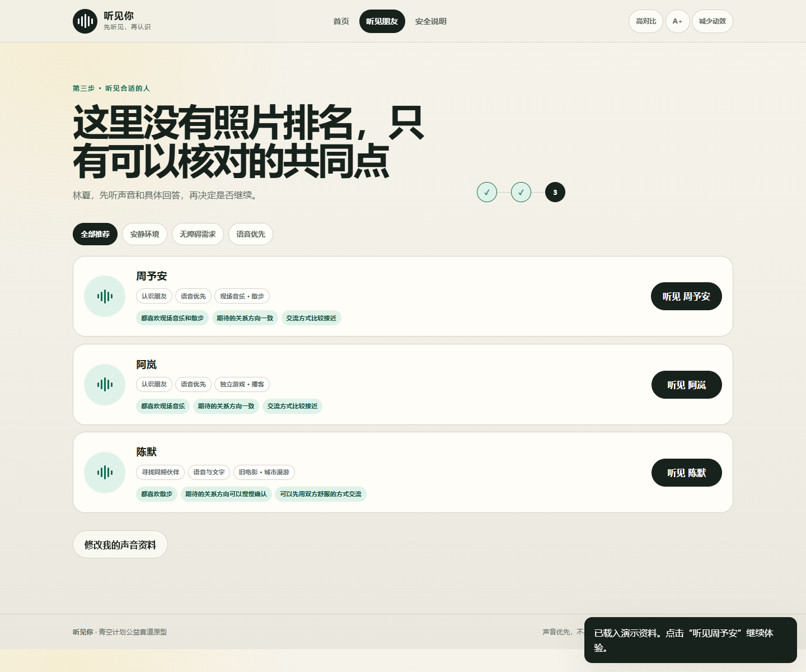

# 听见你

面向视障用户、照片焦虑者和低社交压力人群的语音优先交友原型。

产品不把声音包装成新的“魅力评分”。用户用四段真实回答介绍自己，系统只根据可核对的信息给出推荐理由，并生成一条可朗读、可随时退出的安全见面路线。

## 本次迭代（2026-11-27）

上一版本是无账号的纯静态原型：资料和见面卡只保存在浏览器 `localStorage`，线上只能演示浏览流程。

这一版新增：

- 注册、登录、退出与 30 天登录状态保持，账号页支持登录 / 注册切换、错误提示和已登录面板。
- 双模式账号存储：`npm start` 使用 Node + SQLite（`data/hear-you.db`，scrypt 加盐哈希、HttpOnly Cookie）；GitHub Pages 等静态环境自动切换为浏览器 IndexedDB（PBKDF2 加盐哈希）。
- 见面邀请双方确认：在“约一次轻松见面”确认路线后，会向对方发出邀请（可附一句留言），TA 可同意或婉拒并留下回复。演示中由本机切换到对方视角完成回应；**正式的对方通知与回应需要服务器推送**，静态部署不会跨设备送达。邀请状态与双方消息保存在本地，刷新后不丢。
- 注册成功后自动登录，并把昵称带入声音资料；刷新页面后自动恢复登录状态。
- 新增账号自动化测试，覆盖重复注册、错误密码、会话过期和数据库重开后的再次登录。

## 在线地址

正式演示（GitHub Pages）：<https://esp-jsy.github.io/tingjianni-hear-you/>

注册 / 登录：<https://esp-jsy.github.io/tingjianni-hear-you/#auth>

仓库：<https://github.com/Esp-jsy/tingjianni-hear-you>

> GitHub Pages 上可直接注册和登录，账号保存在当前浏览器的 IndexedDB；通过 `npm start` 运行时会自动切换为服务器 SQLite 数据库，账号可跨浏览器使用。

更新代码与部署方式见下方「部署说明」。

## 部署说明

### GitHub Pages（当前线上演示）

线上地址 <https://esp-jsy.github.io/tingjianni-hear-you/> 由仓库 `main` 分支根目录直接发布，不依赖 GitHub Actions。

- 首次开启：仓库 Settings → Pages → Source 选择 Deploy from a branch，分支选 `main`、目录选 `/ (root)`，保存后等待首次构建。
- 日常更新：本地验证通过后推送到 `main` 即自动重新发布。

```powershell
git add .
git commit -m "更新说明"
git push origin main
```

- 发布通常需要 1～10 分钟；如果页面仍是旧版本，先等构建结束，再用 `Ctrl + F5` 强制刷新（Pages CDN 与浏览器都会缓存 `app.js`、`styles.css`）。
- 静态部署只有前端文件，没有 Node 运行时，`/api` 不存在；页面探测失败后会自动改用浏览器 IndexedDB 保存账号，因此线上账号不能跨设备。
- 静态站点同样包含见面邀请演示：邀请与对方回应都保存在当前浏览器，不会推送到另一台设备。

### Node 服务器（完整账号模式）

项目本身是一个 Node 服务，同一个进程托管静态文件和 `/api`，可以直接部署到任何支持 Node 的平台（Render、Railway、Fly.io、自己的 VPS 等），不需要单独配置前端接口域名。

```powershell
npm start
```

- 默认监听 `0.0.0.0:4173`，可通过环境变量 `PORT`、`HOST` 修改。
- 账号保存在 SQLite 文件 `data/hear-you.db`，可用 `HEAR_YOU_DB` 指定其他路径；部署时要确保该目录可写并纳入备份。
- 建议放在 HTTPS 反向代理之后；登录 Cookie 为 HttpOnly + SameSite=Lax，需要同源访问，登录状态保持 30 天。
- 该模式下账号存服务器数据库，可以跨浏览器、跨设备登录；但仍未提供邮箱验证、找回密码和登录限流。

## 界面预览






## 本地运行

```powershell
npm start
```

打开 <http://127.0.0.1:4173>（默认端口，可用环境变量 `PORT` 修改）。

首次运行会自动创建 SQLite 数据库 `data/hear-you.db`。注册的账号保存在其中，重启服务后仍可继续登录；也可以通过环境变量 `HEAR_YOU_DB` 指定其他数据库文件位置。数据库文件已被 `.gitignore` 排除，不会提交到仓库。

GitHub Pages 等纯静态环境没有 Node API，页面会自动改用浏览器 IndexedDB 保存账号；此时账号只存在于当前浏览器，换设备或清除站点数据后需要重新注册。

麦克风录音需要页面运行在 `localhost` 或 HTTPS 环境。原型支持 Chrome、Edge 等现代浏览器；不支持录音时仍可完成文字填写流程。

## 快速演示

GitHub Pages 在线演示（可直接注册或登录）：

- 匹配页：<https://esp-jsy.github.io/tingjianni-hear-you/?demo=1#matches>
- 声音资料详情：<https://esp-jsy.github.io/tingjianni-hear-you/?demo=1&view=detail>
- 安全见面路线：<https://esp-jsy.github.io/tingjianni-hear-you/?demo=1&view=plan>
- 账号页：<https://esp-jsy.github.io/tingjianni-hear-you/#auth>

本地运行时可打开：

- 匹配页：<http://127.0.0.1:4173/?demo=1#matches>
- 声音资料详情：<http://127.0.0.1:4173/?demo=1&view=detail>
- 安全见面路线：<http://127.0.0.1:4173/?demo=1&view=plan>
- 账号页：<http://127.0.0.1:4173/#auth>

90 秒演示建议从匹配页开始：

1. 点击“听见周予安”，展示真实声音入口。
2. 朗读资料，指出推荐理由只引用共同兴趣和交流偏好。
3. 点击“约一次轻松见面”，生成公共空间路线和离场机制。

## 已实现

- 账号注册、登录与退出：`npm start` 时使用 SQLite + scrypt 加盐哈希 + HttpOnly Cookie；GitHub Pages 静态部署时自动使用浏览器 IndexedDB + PBKDF2 加盐哈希，登录状态保持 30 天。
- 见面邀请与双方确认：发送邀请附言，对方（演示视角）可同意或婉拒并回复，状态点与双方消息在见面卡下方实时更新；真实环境中对方通知与回应需服务器推送。
- 三步资料流程：坐标、声音、匹配。
- 浏览器麦克风录音与可选语音转写。
- 基于兴趣、交流方式、小组偏好和无障碍需求的透明排序。
- 候选人的文字资料、原型朗读和可核对推荐理由。
- 公共空间见面方案、定时提醒、无障碍路线、中性离场消息。
- 高对比模式、放大文字、减少动效、键盘焦点、跳转链接和语义化表单。
- 响应式布局，390px 视口无横向溢出。
- 资料与见面卡保存在当前浏览器的 `localStorage`，录音 Blob 不写入持久存储；本地运行时账号保存在 SQLite，静态部署时账号保存在浏览器 IndexedDB。

## 真实性与边界

- 原型中的候选人声音使用浏览器朗读，并在界面上明确标注；正式产品必须播放用户本人确认过的录音。
- 当前匹配使用可解释的本地规则，没有伪装成大模型语义匹配。
- 原型包含账号注册与登录，但没有作品上传、实时同步或内容审核服务；“离场消息”只在当前页面演示。
- 见面邀请的“对方通知与回应”是本机演示：同意或婉拒都在同一浏览器内完成，静态部署不会向对方设备推送通知；正式版需要服务器推送、消息同步与举报通道。
- 账号是原型实现：GitHub Pages 上的账号只保存在当前浏览器，不能跨设备同步；暂未提供邮箱验证、找回密码和登录限流，正式上线前需要补齐。
- AI 不应生成或克隆声音、代替用户聊天，也不应推测人格、健康、收入或恋爱价值。

## 正式版技术路线

- Web/PWA：Next.js 或 React。
- 音频：对象存储、短时签名 URL、用户可随时撤回和删除。
- 匹配：结构化偏好约束 + 文本向量检索；模型只辅助摘要和活动建议。
- 安全：实名或校园身份验证、举报与屏蔽、活动双方确认、敏感信息最小化。
- 账号与数据：托管数据库和成熟身份服务，补齐邮箱验证、找回密码、登录限流与跨设备同步。
- 无障碍：NVDA、VoiceOver、TalkBack 实机测试，键盘完成所有关键流程。

## 测试

```powershell
npm test
```

`logic.js` 的排序与资料状态、`auth.mjs` 的账号与会话均有 Node 内置测试，无需安装依赖即可运行。浏览器 IndexedDB 账号模式已通过静态站点场景的注册、刷新保持、退出与重新登录验证。
