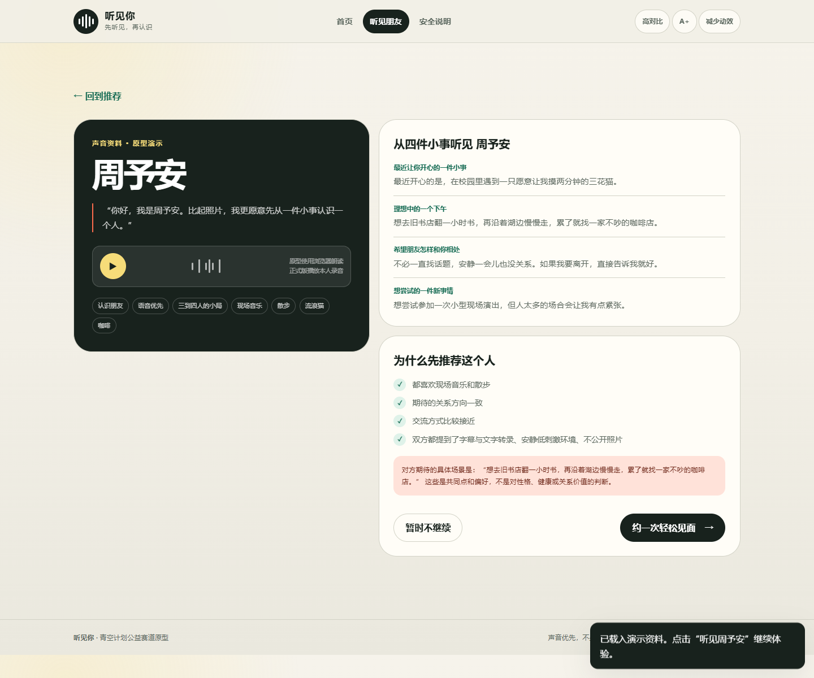

# 听见你

面向视障用户、照片焦虑者和低社交压力人群的语音优先交友原型。

产品不把声音包装成新的“魅力评分”。用户用四段真实回答介绍自己，系统只根据可核对的信息给出推荐理由，并生成一条可朗读、可随时退出的安全见面路线。

## 界面预览




## 本地运行

```powershell
npm start
```

打开 <http://127.0.0.1:4173>。

麦克风录音需要页面运行在 `localhost` 或 HTTPS 环境。原型支持 Chrome、Edge 等现代浏览器；不支持录音时仍可完成文字填写流程。

## 快速演示

直接打开：

- 匹配页：<http://127.0.0.1:4173/?demo=1#matches>
- 声音资料详情：<http://127.0.0.1:4173/?demo=1&view=detail>
- 安全见面路线：<http://127.0.0.1:4173/?demo=1&view=plan>

90 秒演示建议从匹配页开始：

1. 点击“听见周予安”，展示真实声音入口。
2. 朗读资料，指出推荐理由只引用共同兴趣和交流偏好。
3. 点击“约一次轻松见面”，生成公共空间路线和离场机制。

## 已实现

- 三步资料流程：坐标、声音、匹配。
- 浏览器麦克风录音与可选语音转写。
- 基于兴趣、交流方式、小组偏好和无障碍需求的透明排序。
- 候选人的文字资料、原型朗读和可核对推荐理由。
- 公共空间见面方案、定时提醒、无障碍路线、中性离场消息。
- 高对比模式、放大文字、减少动效、键盘焦点、跳转链接和语义化表单。
- 响应式布局，390px 视口无横向溢出。
- 数据只保存在当前浏览器的 `localStorage`，录音 Blob 不写入持久存储。

## 真实性与边界

- 原型中的候选人声音使用浏览器朗读，并在界面上明确标注；正式产品必须播放用户本人确认过的录音。
- 当前匹配使用可解释的本地规则，没有伪装成大模型语义匹配。
- 原型没有上传、账号、实时同步或内容审核服务；“离场消息”只在当前页面演示。
- AI 不应生成或克隆声音、代替用户聊天，也不应推测人格、健康、收入或恋爱价值。

## 正式版技术路线

- Web/PWA：Next.js 或 React。
- 音频：对象存储、短时签名 URL、用户可随时撤回和删除。
- 匹配：结构化偏好约束 + 文本向量检索；模型只辅助摘要和活动建议。
- 安全：实名或校园身份验证、举报与屏蔽、活动双方确认、敏感信息最小化。
- 无障碍：NVDA、VoiceOver、TalkBack 实机测试，键盘完成所有关键流程。

## 测试

```powershell
npm test
```

核心排序和资料状态逻辑位于 `logic.js`，无需安装依赖即可运行 Node 内置测试。
